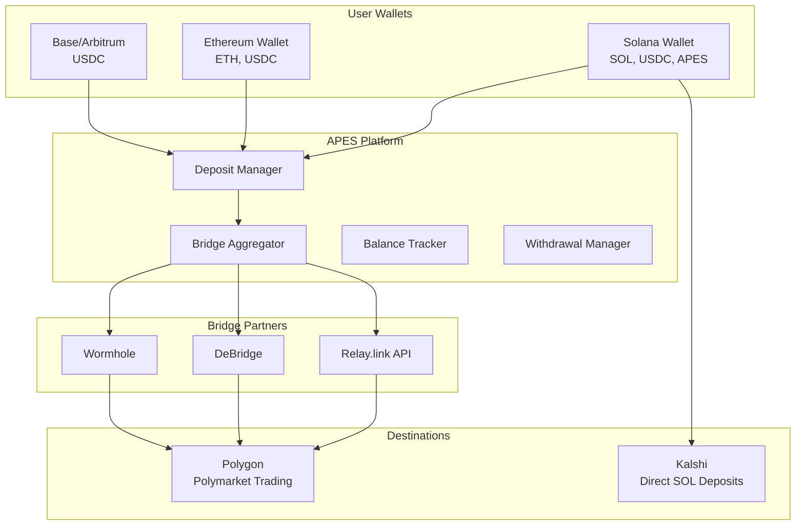

# APES Deposit & Withdrawal System Design

## Overview
Based on research of Verso, Polym, PMX, Flipr, and Relay.link, here's a comprehensive deposit/withdrawal system for APES that enables seamless cross-chain trading.

## Architecture

### 1. Multi-Chain Deposit Support
Users can deposit from multiple chains to trade on Polymarket (Polygon) and Kalshi.



## Implementation Plan

### Phase 1: Core Infrastructure

#### 1.1 Database Schema
```sql
-- User balances across chains
CREATE TABLE user_balances (
  id SERIAL PRIMARY KEY,
  user_wallet VARCHAR(44) NOT NULL,
  chain VARCHAR(20) NOT NULL,
  token VARCHAR(20) NOT NULL,
  balance DECIMAL(20, 6) DEFAULT 0,
  locked_balance DECIMAL(20, 6) DEFAULT 0,
  updated_at TIMESTAMP DEFAULT CURRENT_TIMESTAMP,
  UNIQUE(user_wallet, chain, token)
);

-- Deposit records
CREATE TABLE deposits (
  id SERIAL PRIMARY KEY,
  user_wallet VARCHAR(44) NOT NULL,
  tx_hash VARCHAR(100) UNIQUE NOT NULL,
  source_chain VARCHAR(20) NOT NULL,
  destination_chain VARCHAR(20) NOT NULL,
  token VARCHAR(20) NOT NULL,
  amount DECIMAL(20, 6) NOT NULL,
  bridge_provider VARCHAR(20),
  status VARCHAR(20) DEFAULT 'pending',
  bridge_tx_hash VARCHAR(100),
  created_at TIMESTAMP DEFAULT CURRENT_TIMESTAMP,
  completed_at TIMESTAMP
);

-- Withdrawal requests
CREATE TABLE withdrawals (
  id SERIAL PRIMARY KEY,
  user_wallet VARCHAR(44) NOT NULL,
  destination_wallet VARCHAR(100) NOT NULL,
  destination_chain VARCHAR(20) NOT NULL,
  token VARCHAR(20) NOT NULL,
  amount DECIMAL(20, 6) NOT NULL,
  fee DECIMAL(20, 6) DEFAULT 0,
  status VARCHAR(20) DEFAULT 'pending',
  tx_hash VARCHAR(100),
  created_at TIMESTAMP DEFAULT CURRENT_TIMESTAMP,
  completed_at TIMESTAMP
);

-- Bridge quotes cache
CREATE TABLE bridge_quotes (
  id SERIAL PRIMARY KEY,
  quote_id VARCHAR(100) UNIQUE NOT NULL,
  user_wallet VARCHAR(44) NOT NULL,
  source_chain VARCHAR(20) NOT NULL,
  destination_chain VARCHAR(20) NOT NULL,
  source_token VARCHAR(20) NOT NULL,
  destination_token VARCHAR(20) NOT NULL,
  source_amount DECIMAL(20, 6) NOT NULL,
  destination_amount DECIMAL(20, 6) NOT NULL,
  bridge_fee DECIMAL(20, 6) NOT NULL,
  gas_fee DECIMAL(20, 6) NOT NULL,
  provider VARCHAR(20) NOT NULL,
  quote_data JSONB,
  expires_at TIMESTAMP NOT NULL,
  created_at TIMESTAMP DEFAULT CURRENT_TIMESTAMP
);
```

#### 1.2 Backend Services

**DepositService** (`backend/services/depositService.js`):
```javascript
class DepositService {
  constructor() {
    this.relayClient = new RelayClient(process.env.RELAY_API_KEY);
    this.bridges = {
      relay: this.relayClient,
      debridge: new DebridgeClient(),
      wormhole: new WormholeClient()
    };
  }

  async getBestQuote(params) {
    const { sourceChain, destChain, token, amount } = params;
    
    // Get quotes from all providers
    const quotes = await Promise.all([
      this.getRelayQuote(params),
      this.getDebridgeQuote(params),
      this.getWormholeQuote(params)
    ]);
    
    // Return best quote by total cost
    return quotes
      .filter(q => q.success)
      .sort((a, b) => a.totalCost - b.totalCost)[0];
  }

  async processDeposit(userWallet, quoteId) {
    const quote = await this.getQuoteFromCache(quoteId);
    
    // Record deposit
    const deposit = await this.recordDeposit({
      userWallet,
      ...quote
    });
    
    // Execute bridge
    const result = await this.executeBridge(quote);
    
    // Update user balance on destination chain
    if (result.success) {
      await this.updateUserBalance(
        userWallet,
        quote.destinationChain,
        quote.destinationToken,
        quote.destinationAmount
      );
    }
    
    return result;
  }
}
```

### Phase 2: Relay.link Integration

#### 2.1 Bridge Integration
```javascript
const { getClient } = require('@reservoir0x/relay-sdk');

class RelayBridgeService {
  constructor() {
    this.client = getClient({
      baseApiUrl: "https://api.relay.link",
      apiKey: process.env.RELAY_API_KEY
    });
  }

  async getQuote(params) {
    const { 
      originChain, 
      destinationChain, 
      token, 
      amount, 
      userAddress 
    } = params;

    try {
      const quote = await this.client.quote({
        originChainId: this.getChainId(originChain),
        destinationChainId: this.getChainId(destinationChain),
        token,
        amount,
        user: userAddress,
        // Add 0.5% platform fee
        appFees: [{
          recipient: process.env.APES_FEE_WALLET,
          percentage: 50 // 0.5%
        }]
      });

      return {
        success: true,
        quoteId: quote.quoteId,
        destinationAmount: quote.toAmount,
        bridgeFee: quote.fees.bridge,
        gasFee: quote.fees.gas,
        platformFee: amount * 0.005,
        totalCost: quote.fees.total + (amount * 0.005),
        expires: quote.expiresAt,
        steps: quote.steps
      };
    } catch (error) {
      return { success: false, error: error.message };
    }
  }

  async executeBridge(quote, userSignature) {
    try {
      const result = await this.client.execute({
        quoteId: quote.quoteId,
        userSignature,
        onProgress: (step, status) => {
          this.updateDepositStatus(quote.depositId, step, status);
        }
      });

      return {
        success: true,
        txHash: result.txHash,
        destinationTxHash: result.destinationTxHash
      };
    } catch (error) {
      return { success: false, error: error.message };
    }
  }
}
```

### Phase 3: Frontend Integration

#### 3.1 Deposit Component
```jsx
import React, { useState, useEffect } from 'react';
import { useAppWallet } from '../hooks/useAppWallet';
import { depositService } from '../services/depositService';

export default function DepositModal({ isOpen, onClose }) {
  const { walletAddress, signTransaction } = useAppWallet();
  const [sourceChain, setSourceChain] = useState('solana');
  const [amount, setAmount] = useState('');
  const [quotes, setQuotes] = useState([]);
  const [selectedQuote, setSelectedQuote] = useState(null);
  const [loading, setLoading] = useState(false);

  const supportedChains = [
    { id: 'solana', name: 'Solana', tokens: ['USDC', 'SOL'] },
    { id: 'ethereum', name: 'Ethereum', tokens: ['USDC', 'ETH'] },
    { id: 'base', name: 'Base', tokens: ['USDC'] },
    { id: 'arbitrum', name: 'Arbitrum', tokens: ['USDC'] }
  ];

  const getQuotes = async () => {
    setLoading(true);
    const quotes = await depositService.getQuotes({
      sourceChain,
      destinationChain: 'polygon',
      token: 'USDC',
      amount,
      userAddress: walletAddress
    });
    setQuotes(quotes);
    setLoading(false);
  };

  const executeDeposit = async () => {
    if (!selectedQuote) return;
    
    setLoading(true);
    try {
      // Get user signature
      const signature = await signTransaction(selectedQuote.transaction);
      
      // Execute bridge
      const result = await depositService.executeBridge(
        selectedQuote.quoteId,
        signature
      );
      
      if (result.success) {
        toast.success('Deposit initiated! Funds will arrive in 1-2 minutes.');
        onClose();
      } else {
        toast.error(result.error);
      }
    } catch (error) {
      toast.error('Failed to execute deposit');
    }
    setLoading(false);
  };

  return (
    <Modal isOpen={isOpen} onClose={onClose}>
      <div className="p-6">
        <h2 className="text-2xl font-bold mb-4">Deposit Funds</h2>
        
        {/* Chain Selection */}
        <div className="mb-4">
          <label>From Chain</label>
          <select 
            value={sourceChain} 
            onChange={(e) => setSourceChain(e.target.value)}
            className="w-full p-2 border rounded"
          >
            {supportedChains.map(chain => (
              <option key={chain.id} value={chain.id}>
                {chain.name}
              </option>
            ))}
          </select>
        </div>

        {/* Amount Input */}
        <div className="mb-4">
          <label>Amount (USDC)</label>
          <input
            type="number"
            value={amount}
            onChange={(e) => setAmount(e.target.value)}
            placeholder="100"
            className="w-full p-2 border rounded"
          />
        </div>

        {/* Get Quotes Button */}
        <button
          onClick={getQuotes}
          disabled={!amount || loading}
          className="w-full bg-purple-600 text-white p-2 rounded mb-4"
        >
          {loading ? 'Loading...' : 'Get Quotes'}
        </button>

        {/* Quote Selection */}
        {quotes.length > 0 && (
          <div className="space-y-2 mb-4">
            <h3 className="font-semibold">Select Bridge Option:</h3>
            {quotes.map((quote, idx) => (
              <div
                key={idx}
                onClick={() => setSelectedQuote(quote)}
                className={`p-3 border rounded cursor-pointer ${
                  selectedQuote?.quoteId === quote.quoteId 
                    ? 'border-purple-600 bg-purple-50' 
                    : 'border-gray-300'
                }`}
              >
                <div className="flex justify-between">
                  <span>{quote.provider}</span>
                  <span className="font-semibold">
                    {quote.destinationAmount} USDC
                  </span>
                </div>
                <div className="text-sm text-gray-600">
                  Fee: ${quote.totalFee} • Time: ~{quote.estimatedTime}
                </div>
              </div>
            ))}
          </div>
        )}

        {/* Execute Button */}
        {selectedQuote && (
          <button
            onClick={executeDeposit}
            disabled={loading}
            className="w-full bg-green-600 text-white p-2 rounded"
          >
            {loading ? 'Processing...' : 'Complete Deposit'}
          </button>
        )}
      </div>
    </Modal>
  );
}
```

### Phase 4: Polymarket Integration

#### 4.1 Trading with Deposited Funds
```javascript
class PolymarketTradingService {
  async placeOrder(userWallet, orderParams) {
    // Check user has sufficient balance
    const balance = await this.getUserBalance(
      userWallet, 
      'polygon', 
      'USDC'
    );
    
    if (balance < orderParams.amount) {
      throw new Error('Insufficient balance. Please deposit funds.');
    }
    
    // Lock funds for order
    await this.lockFunds(
      userWallet,
      orderParams.amount
    );
    
    // Execute trade on Polymarket
    const result = await this.polymarketProxy.placeOrder(
      userWallet,
      orderParams
    );
    
    // Update balances based on result
    if (result.success) {
      await this.deductBalance(
        userWallet,
        orderParams.amount
      );
    } else {
      await this.unlockFunds(
        userWallet,
        orderParams.amount
      );
    }
    
    return result;
  }
}
```

### Phase 5: Withdrawal System

#### 5.1 Withdrawal Service
```javascript
class WithdrawalService {
  async requestWithdrawal(params) {
    const { userWallet, amount, destinationChain, destinationAddress } = params;
    
    // Verify balance
    const balance = await this.getUserBalance(userWallet, 'polygon', 'USDC');
    if (balance < amount) {
      throw new Error('Insufficient balance');
    }
    
    // Lock funds
    await this.lockFunds(userWallet, amount);
    
    // Get bridge quote for withdrawal
    const quote = await this.bridgeService.getQuote({
      sourceChain: 'polygon',
      destinationChain,
      amount,
      token: 'USDC'
    });
    
    // Execute withdrawal
    const result = await this.executeBridge(quote);
    
    // Record withdrawal
    await this.recordWithdrawal({
      userWallet,
      destinationAddress,
      ...result
    });
    
    return result;
  }
}
```

## Security Considerations

1. **Non-Custodial Design**: Users maintain control of funds
2. **Balance Verification**: Real-time blockchain verification
3. **Transaction Limits**: Daily/per-transaction limits
4. **Monitoring**: Anomaly detection for unusual activity
5. **Multi-Sig**: Platform fee wallet uses multi-sig

## Fee Structure

| Operation | Fee | Notes |
|-----------|-----|-------|
| Deposit | 0.5% | Platform fee on top of bridge fees |
| Trading | 0.2-1% | Based on APES holdings |
| Withdrawal | 0.5% | Platform fee + bridge fees |
| Small deposits (<$100) | $2 minimum | To cover gas costs |

## Benefits for APES Holders

- **50% discount on deposit/withdrawal fees** for 10k+ APES
- **Priority processing** for large deposits
- **Exclusive bridge routes** with better rates
- **Fee rebates** distributed monthly

## Implementation Timeline

1. **Week 1-2**: Database schema and basic deposit service
2. **Week 3-4**: Relay.link integration
3. **Week 5-6**: Frontend deposit/withdrawal UI
4. **Week 7-8**: Testing and security audit
5. **Week 9-10**: Beta launch with limited users
6. **Week 11-12**: Full launch

## Next Steps

1. Set up Relay.link API access
2. Create deposit service architecture
3. Implement balance tracking system
4. Build deposit UI components
5. Test with small amounts on testnet
6. Security audit before mainnet launch