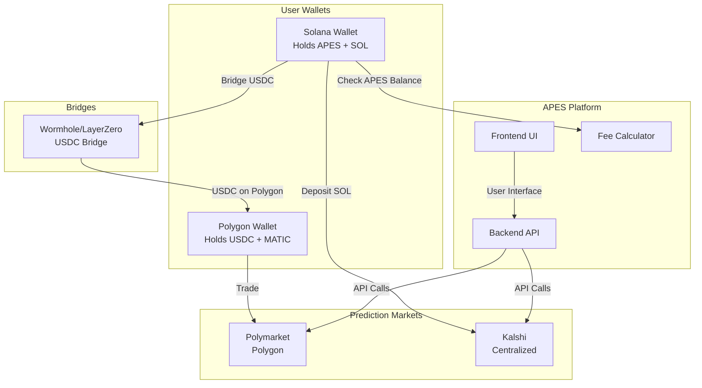

# Correct Approach: APES Integration with Prediction Markets

## Executive Summary
After researching both Kalshi and Polymarket, the reality is that **users must deposit funds** on each platform. There's no magical cross-chain solution that lets users trade on Polygon with Solana funds without bridging. Here's the correct approach.

## Platform Comparison

### Polymarket
- **Blockchain**: Polygon (Layer 2)
- **Trading Currency**: USDC only
- **Gas Token**: MATIC required
- **Deposits**: Users must have USDC on Polygon
- **API**: Full programmatic trading support

### Kalshi
- **Type**: CFTC-regulated exchange (centralized)
- **Trading Currency**: USD (fiat)
- **Deposits**: Fiat, crypto (BTC, SOL, USDC), cards
- **Crypto Deposit**: Via Zero Hash, up to $500k
- **API**: Trading only, no deposit/withdrawal API

## Realistic Integration Approaches

### Option 1: Custodial Model (Current Implementation)
**How it works:**
1. Platform holds funded proxy wallets on Polygon
2. Users deposit USDC to platform's Solana treasury
3. Platform executes trades using proxy wallets
4. Platform handles all bridging/funding

**Pros:**
- Seamless UX
- No user bridging required
- Gasless for users

**Cons:**
- Regulatory risk (custodial)
- Platform needs liquidity
- Trust required

**Implementation:**
```javascript
// User flow
1. User deposits USDC to APES treasury (Solana)
2. Platform credits internal balance
3. User trades via API using proxy wallet
4. Platform settles winnings back to Solana

// Platform responsibilities
- Maintain liquidity on Polygon
- Handle Solana ↔ Polygon bridging
- Manage proxy wallet funding
- Track user balances
```

### Option 2: Non-Custodial Bridge Integration
**How it works:**
1. Integrate bridge UI (Wormhole, LayerZero)
2. Users bridge their own USDC to Polygon
3. Users trade directly on Polymarket
4. APES provides UI and fee discounts

**Pros:**
- Non-custodial
- No regulatory issues
- Users control funds

**Cons:**
- Complex UX
- Users need MATIC
- Bridge fees/time

**Implementation:**
```javascript
// User flow
1. Connect Solana wallet
2. Bridge USDC Solana → Polygon via integrated UI
3. Claim USDC on Polygon to their wallet
4. Trade on Polymarket with APES UI
5. Bridge winnings back if desired

// APES provides
- Integrated bridge UI
- Fee tier based on APES holdings
- Trading interface
- Position tracking
```

### Option 3: Hybrid Approach (Recommended)
**How it works:**
1. Small trades: Use custodial proxy wallets
2. Large trades: Guide users through self-custody
3. Offer both options with clear tradeoffs

**Features:**
```yaml
Custodial Path:
  - Max: $1,000 per user
  - Instant trading
  - No bridge needed
  - Higher platform fees

Self-Custody Path:
  - Unlimited amounts
  - Lower fees for APES holders
  - Bridge integration
  - Full user control
```

## For Kalshi Integration

Since Kalshi is centralized and accepts SOL directly:

```javascript
// Simpler integration
1. User deposits SOL to Kalshi via their UI
2. APES tracks user's Kalshi balance
3. User trades through APES interface
4. Kalshi handles settlement

// Benefits
- No bridging needed
- SOL deposits supported
- Regulated platform
- Simple integration
```

## Required Infrastructure

### For Polymarket:
1. **Bridge Integration**
   - Wormhole SDK for USDC bridging
   - UI for bridge operations
   - Bridge fee estimation

2. **Wallet Management**
   - Multi-wallet support (Solana + EVM)
   - MetaMask integration for Polygon
   - Wallet connection flow

3. **Liquidity Management** (if custodial)
   - Treasury on both chains
   - Automated rebalancing
   - Risk management

### For Kalshi:
1. **OAuth Integration**
   - User authorization
   - Balance tracking
   - Order placement

2. **Deposit Tracking**
   - Monitor SOL deposits
   - Update user credits

## The Reality Check

**What doesn't work:**
- ❌ Trading on Polygon with Solana funds without bridging
- ❌ Magically reading Solana balance to trade on Polygon
- ❌ Gasless Polygon transactions without relayer

**What does work:**
- ✅ Custodial proxy wallets (with regulatory considerations)
- ✅ Integrated bridging UI for self-custody
- ✅ Kalshi's direct SOL deposit support
- ✅ Hybrid approach with user choice

## Recommended Implementation Plan

### Phase 1: Kalshi Integration (Easier)
1. Build OAuth flow
2. Create trading interface
3. Track user positions
4. Handle SOL deposits via Kalshi

### Phase 2: Polymarket Self-Custody
1. Add MetaMask support
2. Integrate bridge UI
3. Create trading interface
4. APES fee discounts based on holdings

### Phase 3: Polymarket Custodial (Optional)
1. Legal review
2. Implement deposit/withdrawal system
3. Fund proxy wallets
4. Risk management system

## Technical Architecture



## Cost Analysis

### User Costs:
- **Bridge fees**: ~$20-50 per transfer
- **Polygon gas**: ~$0.01-0.10 per trade
- **Platform fees**: 0.2%-1% based on APES holdings

### Platform Costs (if custodial):
- **Liquidity**: Need float on both chains
- **Bridge fees**: Bulk bridging
- **Gas costs**: Funding proxy wallets
- **Security**: Audit and insurance

## Conclusion

The correct approach requires acknowledging that:
1. **Users must have funds on the trading chain** (or platform must custodize)
2. **Bridging is necessary** for cross-chain operations
3. **Each platform has different requirements**
4. **Regulatory compliance is crucial** for custodial models

The best path forward is likely the hybrid approach: start with Kalshi (simpler), add Polymarket with self-custody, and consider custodial options only after legal review.